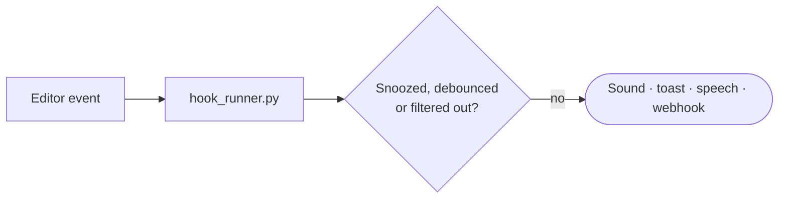

<div align="center">


# echook

### Know when your agent needs you.

A sound, a desktop toast or a message on your phone when Claude Code, Cursor or Codex finishes, asks for permission or hits a rate limit.

<a href="docs/INSTALLATION_GUIDE.md"></a> <a href="plugins/audio-hooks/skills/audio-hooks/SKILL.md"></a> <a href="docs/STATUS_LINE.md"></a> <a href="CHANGELOG.md"></a>

</div>

<br>

<a href="#try-it"></a>

<br>

https://github.com/user-attachments/assets/eb723799-6e06-42d6-8855-addcdf74888f

<sub>Every frame is code: a replica of echook's terminal UI in Remotion, with a synthesised score. How it was made: <a href="https://github.com/ChanMeng666/film-echook-terminal">film-echook-terminal</a>.</sub>

<details>
<summary><sub>The first film (89 s)</sub></summary>

https://github.com/user-attachments/assets/804dff1e-56d8-49b2-b0c0-6706f3eeccd4

<sub>Made with Remotion, Claude Code, ElevenLabs and Suno. How it was made: <a href="https://github.com/ChanMeng666/echook-promo-video">echook-promo-video</a>.</sub>

</details>

## Try it

Say this to your agent in Claude Code, Cursor or Codex:

> *Install echook from `github.com/ChanMeng666/echook` and set it up for me.*

It reads the docs, runs every command and checks the result. Two steps stay with you: type `/reload-plugins` once in Claude Code, or restart the editor once on the Cursor and Codex install paths.

After that, every setting is a sentence:

> *Mute audio for an hour.* · *Switch to chimes.* · *Put a context-usage bar in my status line.*

## Why echook

- **You choose what you hear.** 39 hook events, each with its own sound. Three are on by default.
- **Settings are sentences.** Your agent runs one `audio-hooks` command for each. There is no config file to edit by hand.
- **It reaches you away from the screen.** A sound at your desk, a desktop toast, a spoken summary, or a webhook to Slack, Discord, Teams or ntfy.
- **The status line shows the agent you are watching.** Open a subagent in Claude Code and the line switches to that agent's model, effort and context. Claude Code alone keeps showing the main agent's.





It runs on your machine, on Windows, macOS and Linux. No telemetry: data leaves your computer only if you set a webhook, and then only to the URL you chose.

## For your agent

This page is all a person needs. Everything else is written for agents: clone the repo and point yours at [`AGENTS.md`](AGENTS.md) or [`llms.txt`](llms.txt). Once echook is installed, one command returns its live state:

```bash
audio-hooks manifest
```

<sub>[Install guide](docs/INSTALLATION_GUIDE.md) · [Troubleshooting](docs/TROUBLESHOOTING.md) · [Changelog](CHANGELOG.md) · [Privacy](PRIVACY.md) · [Contributing](CONTRIBUTING.md) · [MIT](LICENSE)</sub>

<sub>Built by [Chan Meng](https://github.com/ChanMeng666).</sub>
