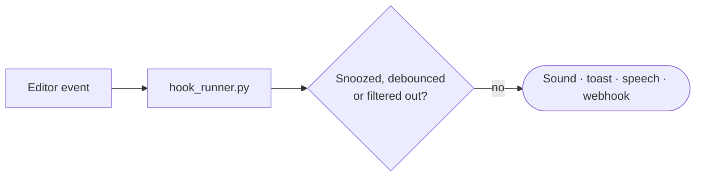

<div align="center">


# echook

### Know when your agent needs you.

A sound, a desktop toast or a message on your phone when Claude Code, Cursor or Codex finishes, asks for permission or hits a rate limit.

<a href="docs/INSTALLATION_GUIDE.md"></a> <a href="docs/NATURAL_LANGUAGE_CONTROL.md"></a> <a href="docs/STATUS_LINE.md"></a> <a href="CHANGELOG.md"></a>

</div>

<br>

<a href="docs/overview.md"></a>

<br>

<!-- FILM PLACEHOLDER
     Chan: the video below is the earlier first film (89 s). Edit this file on
     github.com, drag the echook film (60 s, 16:9) (.mp4) into the editor, and let the new
     link replace the one below. Then delete this whole comment. Leave one
     blank line above and below the link.
-->

https://github.com/user-attachments/assets/804dff1e-56d8-49b2-b0c0-6706f3eeccd4

## Try it

Say this to your agent in Claude Code, Cursor or Codex:

> *Install echook from `github.com/ChanMeng666/echook` and set it up for me.*

It reads the docs, runs every command and checks the result. Two steps stay with you: type `/reload-plugins` once in Claude Code, or restart the editor once on the Cursor and Codex install paths.

After that, every setting is a sentence:

> *Mute audio for an hour.* · *Switch to chimes.* · *Put a context-usage bar in my status line.*

## Why echook

- **You choose what you hear.** 39 hook events, each with its own sound. Three are on by default.
- **Settings are sentences.** Your agent runs one `audio-hooks` command for each. There is no config file to edit by hand.
- **It reaches you away from the screen.** A sound at your desk, a desktop toast, a spoken summary, or a webhook to Slack, Discord, Teams or ntfy.



It runs on your machine, on Windows, macOS and Linux. No telemetry: data leaves your computer only if you set a webhook, and then only to the URL you chose.

## For your agent

This page is all a person needs. Everything else is written for agents: clone the repo and point yours at [`AGENTS.md`](AGENTS.md) or [`llms.txt`](llms.txt). Once echook is installed, one command returns its live state:

```bash
audio-hooks manifest
```

<sub>[Full overview](docs/overview.md) · [Install guide](docs/INSTALLATION_GUIDE.md) · [CLI reference](docs/CLI_REFERENCE.md) · [Troubleshooting](docs/TROUBLESHOOTING.md) · [Changelog](CHANGELOG.md) · [Privacy](PRIVACY.md) · [Contributing](CONTRIBUTING.md) · [MIT](LICENSE)</sub>

<sub>Built by [Chan Meng](https://github.com/ChanMeng666).</sub>
